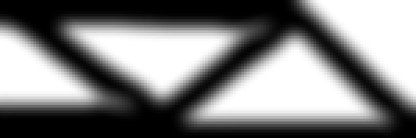
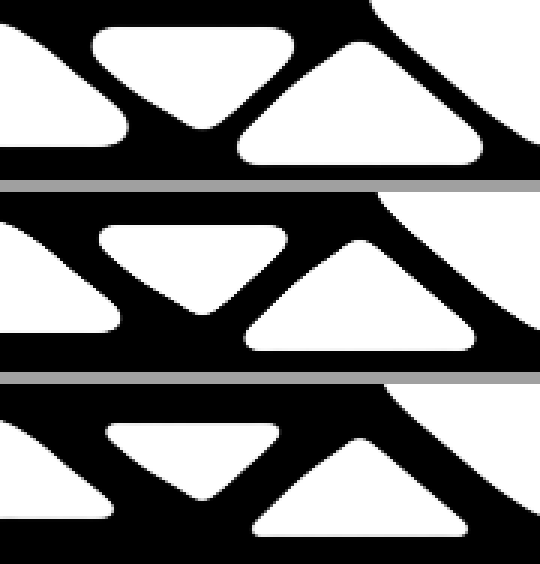

# michell

Generative design by topology optimisation: a Rust engine with a Python interface.

michell computes the material layout of a structural part from its design space, supports, loads and
design objectives. It takes a 3D model of the design space together with a problem definition and returns an
optimised 3D model and a report of the results. The method is density-based topology optimisation: a
finite-element analysis coupled with a gradient-based optimiser. Results are reproducible: on a given machine
and thread count, identical inputs produce identical outputs.

The library is named after A. G. M. Michell, whose 1904 paper on minimum-weight frame structures is the
classical starting point of structural layout optimisation.

## Status

Pre-alpha. The 2D engine, milestone 1 of the [roadmap](docs/roadmap.md), and the 3D engine of milestone 2 are
available. The 2D engine is plane-stress analysis on a grid of square elements with a direct solver, the
density filter, two optimisers (optimality criteria and the method of moving asymptotes), and the compliance
and mass responses. The 3D engine is analysis on a grid of cube elements whose stiffness matrix is never
assembled, solved on several threads by conjugate gradients preconditioned with multigrid, together with the
Helmholtz filter, the projection and several designs from one set of variables (the robust formulation),
optimised by the method of moving asymptotes with the same responses. Both are checked against closed-form
solutions, finite differences, a published reference code, published optima and, in 3D, the finite-element
program CalculiX on the same mesh, in the [verification table](docs/verification.md). CAD input, the problem
file and a command-line tool that runs it are not yet implemented, the run-time and memory measurements that
complete milestone 2 are not yet published, and no release has been published.

## Examples

The MBB beam of the 88-line topology optimisation code (Andreassen et al., 2011), from
[`examples/mbb_beam.py`](examples/mbb_beam.py):

```python
import numpy as np

import michell

# Half of the MBB beam: 150 by 50 square elements of side 1 mm, thickness 1 mm.
nx, ny = 150, 50
grid = michell.Grid(nx, ny, 1.0, 1.0)

# x held on the left edge (the symmetry line), y held at the bottom-right corner (the support).
held = np.zeros(grid.n_dofs, dtype=bool)
for j in range(ny + 1):
    held[2 * grid.node(0, j)] = True
held[2 * grid.node(nx, 0) + 1] = True

# A unit load down at the top-left corner.
loads = np.zeros(grid.n_dofs)
loads[2 * grid.node(0, ny) + 1] = -1.0

material = michell.Material(youngs_modulus=1.0, poisson_ratio=0.3, density_g_cm3=1000.0)
problem = michell.Problem(grid, held, material, [michell.LoadCase("load", loads)], penalty=3.0, e_min=1e-9)

# Least compliance with at most half the material, until no design variable changes by more than 0.01.
result = michell.optimise(
    problem,
    goal=michell.Compliance(),
    limits=[michell.Limit(michell.Mass(), at_most=0.5 * nx * ny)],
    filters=[michell.DensityFilter(grid, 6.0)],
    optimiser=michell.OptimalityCriteria(move_limit=0.2),
    x=np.full(grid.n_elements, 0.5),
    passes=1000,
    stop_change=0.01,
)
print(f"{len(result.passes)} passes, compliance {result.goal:.2f} N mm")
```



*The result: half of a simply supported beam with a central load, its symmetry line on the left; black is
solid material. The script writes this picture to `docs/images/mbb_150x50.png`.*

The 3D cantilever from [`examples/cantilever_3d.py`](examples/cantilever_3d.py), with the Helmholtz filter
and the method of moving asymptotes:

```python
import numpy as np

import michell

nx, ny, nz = 64, 32, 32
# The block: nx by ny by nz cube elements of side 1 mm.
grid = michell.Grid3d(nx, ny, nz, 1.0)

# Clamped on the face x = 0: every degree of freedom of its nodes held.
held = np.zeros(grid.n_dofs, dtype=bool)
for k in range(nz + 1):
    for j in range(ny + 1):
        node = grid.node(0, j, k)
        held[3 * node : 3 * node + 3] = True

# 1000 N down (-z) along the lower edge of the free end, as consistent nodal forces of a uniform line load.
loads = np.zeros(grid.n_dofs)
for j in range(ny + 1):
    share = 0.5 if j in (0, ny) else 1.0
    loads[3 * grid.node(nx, j, 0) + 2] = -1000.0 / ny * share

steel = michell.Material(youngs_modulus=210000.0, poisson_ratio=0.3, density_g_cm3=7.85)
problem = michell.Problem(grid, held, steel, [michell.LoadCase("tip", loads)], threads=4)

# Least compliance with at most 15 % of the block's mass.
block_mass = steel.mass_g(grid.voxel_volume_mm3 * grid.n_elements)
mass_limit = 0.15 * block_mass
pde_filter = michell.HelmholtzFilter(grid, 2.5, threads=4)
result = michell.optimise(
    problem,
    goal=michell.Compliance(),
    limits=[michell.Limit(michell.Mass(), at_most=mass_limit)],
    filters=[pde_filter],
    optimiser=michell.MovingAsymptotes(),
    x=np.full(grid.n_elements, 0.15),
    passes=120,
)
print(f"compliance {result.passes[0].goal:.4g} -> {result.passes[-1].goal:.4g} N mm")
```


*The 3D result, 64 x 32 x 32 elements: the density summed along y (from the side, clamped face on the left),
along z (from above) and along x (from the free end); darker where more material lies.*



*The MBB beam with the robust formulation, from [`examples/mbb_beam_robust.py`](examples/mbb_beam_robust.py):
the eroded, the nominal and the dilated design of one set of variables, top to bottom; black is solid.*

## Planned scope

- Stiffness-driven design in 2D and 3D under mass, stress and deflection constraints
- Multiple load cases, keep-in and keep-out regions, symmetry and minimum member size
- STEP and STL input, STL and 3MF output
- Further physics (heat conduction, natural frequency, buckling) and manufacturing constraints as separate
  modules, each with its own verification cases
- Three interfaces to one engine: a command-line tool, a Python API, and a structured interface (a published
  schema, machine-readable results and errors) for integration into other software and automated workflows
- A public verification table in which every supported feature is checked against closed-form solutions and
  against other codes

## Design documents

- [`docs/design/modules.md`](docs/design/modules.md): how objectives, constraints and shape rules are defined
- [`docs/design/engine-boundary.md`](docs/design/engine-boundary.md): the division of work between the Rust
  engine and Python
- [`docs/design/problem-file.md`](docs/design/problem-file.md): the draft format of the problem definition

## Building from source

Requirements: Rust 1.85 or later ([rustup.rs](https://rustup.rs)) and Python 3.10 or later.

    pip install .
    michell --version

To run the tests (the Python tests use the installed package):

    cargo test
    pip install pytest scipy
    pytest              # the fast tests
    pytest -m slow      # the long runs: the larger MBB beams, the example scripts, the full-size 3D rows
    pytest -m ""        # everything

To run every verification row and rewrite the verification table:

    python -m michell.verification --reference tests/reference --out docs/verification.md

## Repository layout

| Path | Contents |
|---|---|
| `crates/michell` | The engine: a Rust library with no Python dependency |
| `crates/michell-py` | The Python bindings, compiled into the module `michell._engine` |
| `python/michell` | The Python package; `michell.verification` holds the verification rows |
| `tests` | The Python test suite, and the reference results in `tests/reference` |
| `examples` | Example scripts |
| `benchmarks` | A script that measures run time, solver steps and memory of the 3D cantilever |
| `tools/reference` | The scripts that run the reference programs (the 88-line code, CalculiX) and store their numbers |
| `docs` | The roadmap, the verification table, the design notes and the examples' pictures |
| `schema` | The schema of the problem definition (draft) |

## Licence

Licensed under either of the [Apache License, Version 2.0](LICENSE-APACHE) or the [MIT licence](LICENSE-MIT),
at your option.

Unless you explicitly state otherwise, any contribution intentionally submitted for inclusion in this work by
you, as defined in the Apache-2.0 licence, shall be dual licensed as above, without any additional terms or
conditions.
